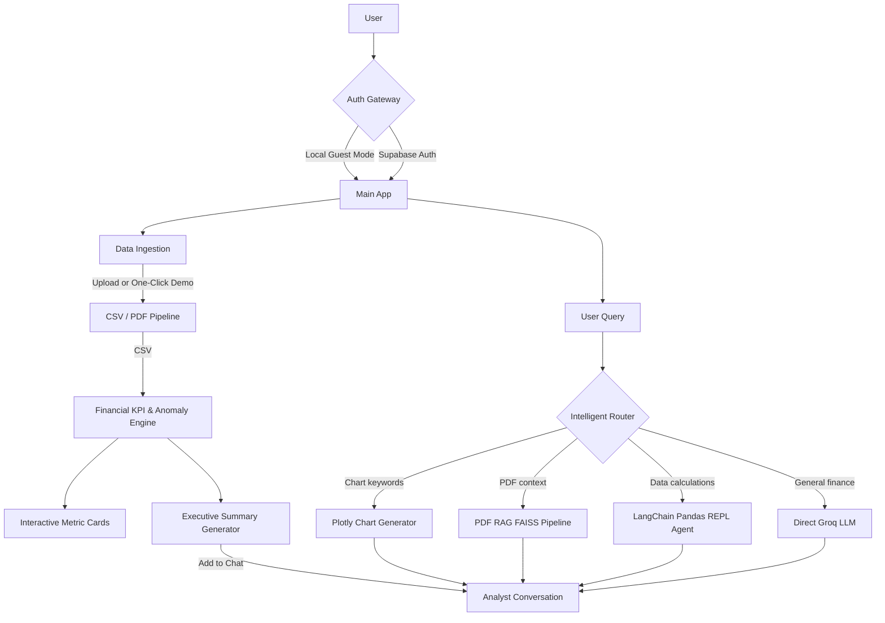

# 📊 FinSight — AI Financial Analysis Platform

A production-ready AI financial analysis platform built with Streamlit, LangChain, and Groq. Upload CSV datasets or corporate PDFs, ask questions in natural language, and get verified analytics, interactive charts, and AI-driven insights — featuring one-click demo data, automated executive summaries, and built-in KPI calculation engines.


-darkgreen?logo=supabase)


---

## ✨ Features

| Feature | Description |
|---------|-------------|
| ⚡ **One-Click Demo Datasets** | Instantly load bundled sample sales CSV & annual report PDF with one click — no file hunt needed |
| 🏛️ **Executive Summary Generator** | Synthesizes dataset metrics into a 5-section executive report (verdict, highlights, drivers, risks, recommendations) with one-click chat export |
| 📈 **Financial KPI & Anomaly Engine** | Computes Revenue, Cost, Net Margin %, MoM Growth, and scans for negative-margin or statistical outliers |
| 🚀 **Instant Guest Mode** | Jump right in without database setup — auto-detects unconfigured Supabase and enables local session mode |
| 🔐 **User Authentication (Optional)** | Supabase email/password signup & login for multi-user environments |
| 💾 **Persistent Chat History** | Conversations can be saved to Supabase PostgreSQL or kept in local session memory |
| 📄 **CSV Analysis (Pandas Agent)** | Upload any CSV — LangChain pandas agent executes actual Python code to compute verified figures |
| 📑 **PDF Q&A with RAG** | Upload any PDF (reports, 10-Ks, contracts) — FAISS vector search and LangChain RAG pipeline |
| 🔍 **OCR for Scanned PDFs** | Automatically extracts text from scanned/image-only PDFs using Tesseract OCR |
| 📊 **Smart Interactive Charts** | Auto-generates Plotly bar, line, pie, scatter, and histogram charts with dark/light theme support |
| 🎤 **Voice Input** | Speak your questions directly — transcribed via Groq Whisper (`whisper-large-v3`) |
| 🧠 **General Finance AI** | Ask macroeconomic, valuation, or accounting questions with smart query routing |
| 🎨 **Premium Glassmorphic UI** | Responsive dark/light theme with glassmorphism styling and real-time status indicators |

---

## 🏗️ Architecture



---

## 🚀 Quick Start

### Prerequisites

- Python 3.11+
- A free [Groq API key](https://console.groq.com/keys)
- *Optional:* A free [Supabase project](https://supabase.com/dashboard) (only needed if you want cloud auth & cross-device persistence)
- *Optional:* [Tesseract OCR](https://github.com/UB-Mannheim/tesseract/wiki) (only needed for scanned image-only PDFs)

---

### Local Setup

```bash
# 1. Clone the repository
git clone https://github.com/prasad-9699/ai-financial-analyst-agent.git
cd ai-financial-analyst-agent

# 2. Create and activate a virtual environment
python -m venv .venv
.\.venv\Scripts\Activate.ps1       # Windows PowerShell
# source .venv/bin/activate        # macOS/Linux

# 3. Install dependencies
pip install -r requirements.txt

# 4. Configure environment
Copy-Item .env.example .env        # Windows PowerShell
# cp .env.example .env             # macOS/Linux
```

Open `.env` and add your **Groq API Key**:
```env
GROQ_API_KEY=gsk_your_groq_api_key_here
```

*(You can leave `SUPABASE_URL` and `SUPABASE_KEY` empty to run in **Instant Guest Mode**).*

```bash
# 5. Launch the Streamlit application
streamlit run app.py
```
Open **`http://localhost:8501`** in your browser.

---

### One-Click Demo Data & Executive Summary

1. Click **"🚀 Load Both Demo Datasets"** in the sidebar.
2. Review the live **Financial KPI Cards** (Total Revenue, Operating Cost, Net Profit, Top Driver).
3. Click **"🚀 Generate Executive Summary"** to produce an executive-grade analysis.
4. Click **"💬 Add to Analyst Chat"** or use the suggestion chips below to explore deeper.

---

### Supabase Cloud Setup (Optional)

If you want multi-user authentication and database-persisted chat histories:

1. Create a project at [supabase.com/dashboard](https://supabase.com/dashboard).
2. Go to **Settings → API** and copy the **Project URL** and **anon public key**.
3. Add them to your `.env` file:
   ```env
   SUPABASE_URL=https://your-project.supabase.co
   SUPABASE_KEY=eyJh...
   ```
4. Run this schema in the Supabase **SQL Editor**:

```sql
CREATE TABLE IF NOT EXISTS chat_history (
    id          BIGINT GENERATED ALWAYS AS IDENTITY PRIMARY KEY,
    user_id     UUID NOT NULL,
    role        TEXT NOT NULL CHECK (role IN ('user', 'assistant')),
    content     TEXT NOT NULL,
    badge       TEXT,
    route       TEXT,
    created_at  TIMESTAMPTZ DEFAULT now()
);

CREATE INDEX IF NOT EXISTS idx_chat_history_user_id
    ON chat_history(user_id, created_at DESC);

ALTER TABLE chat_history ENABLE ROW LEVEL SECURITY;

CREATE POLICY "Users read own messages"
    ON chat_history FOR SELECT USING (auth.uid() = user_id);

CREATE POLICY "Users insert own messages"
    ON chat_history FOR INSERT WITH CHECK (auth.uid() = user_id);

CREATE POLICY "Users delete own messages"
    ON chat_history FOR DELETE USING (auth.uid() = user_id);
```

---

## 📁 Project Structure

```
ai-finance-analyst/
├── app.py                      # Main Streamlit application (Guest mode, Hub, Chat UI)
├── src/
│   ├── financial_metrics.py    # KPI calculations, anomaly detection, executive summary generator
│   ├── config.py               # Configuration validation and structured logging
│   ├── llm.py                  # Groq LLM factory with retry handlers
│   ├── csv_agent.py            # Pandas DataFrame REPL agent with fallback logic
│   ├── pdf_rag.py              # PDF chunking, FAISS embeddings & RAG retrieval
│   ├── charts.py               # Plotly chart generator with automatic column mapping
│   ├── router.py               # Natural language intent router (CSV vs PDF vs Chart vs General)
│   ├── supabase_client.py      # Cloud authentication & chat persistence
│   └── utils.py                # File size and content validation utilities
├── data/
│   ├── sample_sales.csv        # Pre-packaged financial transaction dataset
│   └── annual_report.pdf       # Pre-packaged corporate annual report document
├── tests/
│   ├── test_financial_metrics.py # Unit tests for KPI calculations & anomaly detection
│   ├── test_charts.py          # Unit tests for chart generation & column detection
│   ├── test_router.py          # Unit tests for query routing logic
│   └── test_utils.py           # Unit tests for validators and helpers
├── Dockerfile                  # Container deployment (with Tesseract & Poppler)
├── requirements.txt            # Python dependencies
└── .env.example                # Environment variable template
```

---

## 🧪 Testing

Run all unit tests using pytest:

```bash
pytest tests/ -v
```

---

## 📝 License

MIT License — see [LICENSE](LICENSE) for details.
